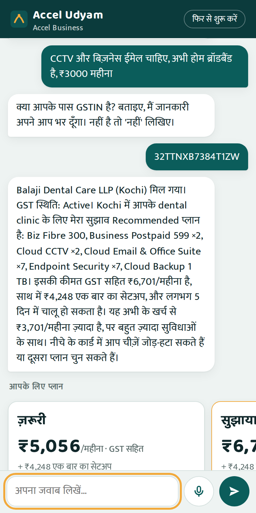
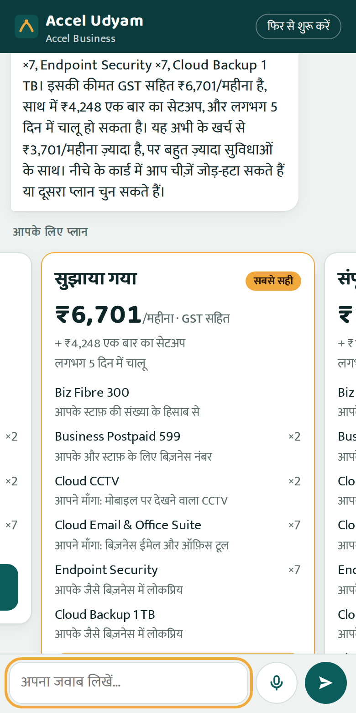
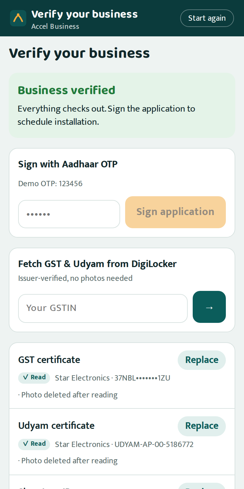
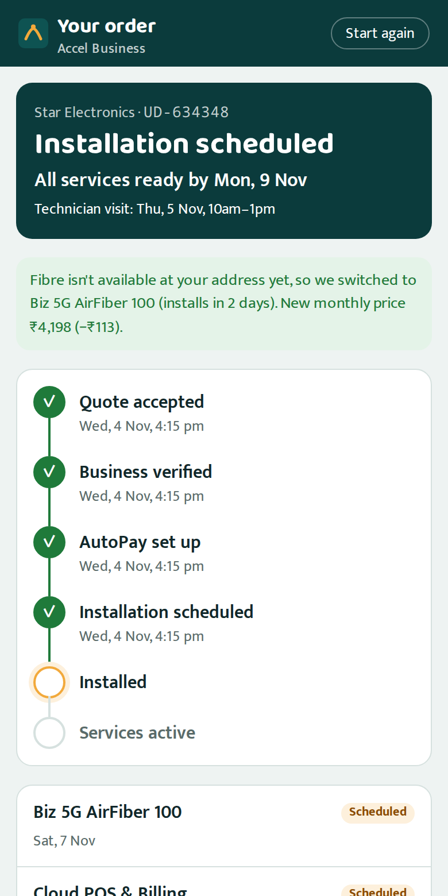
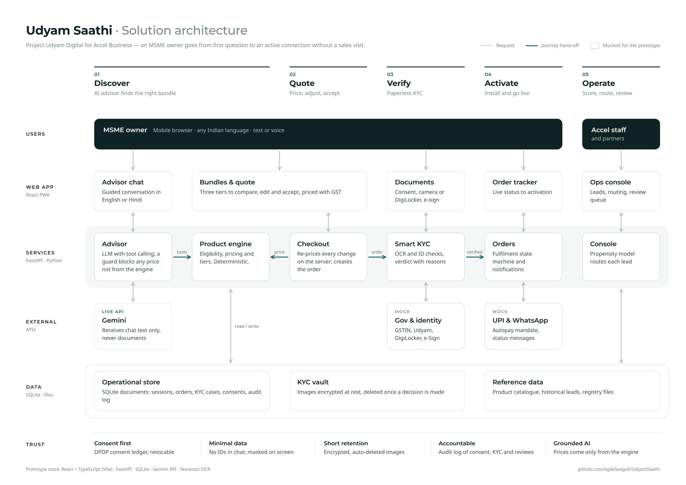

# Udyam Saathi

**From first question to an active business connection — no sales visit, no paperwork, in the owner's own language.**

Prototype for **Project Udyam Digital** · YTL Hackathon 2026 · Enterprise Track A.
Built for *Accel Business*, the case's fictional telecom operator serving India's small businesses (MSMEs).

▶ **[Watch the 3-minute demo](https://drive.google.com/file/d/1-a3ST8SOD1w0_sS1sOaOeT6owczay4UK/view?usp=sharing)**

<table>
  <tr>
    <td align="center"><br><sub><b>1 · Chat</b><br>AI advisor, any language</sub></td>
    <td align="center"><br><sub><b>2 · Choose</b><br>three priced bundles</sub></td>
    <td align="center"><br><sub><b>3 · Verify</b><br>KYC in minutes</sub></td>
    <td align="center"><br><sub><b>4 · Track</b><br>live status to activation</sub></td>
  </tr>
</table>

## Submission

| Deliverable | Where |
|---|---|
| Working prototype | This repo — [run it in 3 commands](#run-it) |
| Demo video (≤ 3 min) | [Watch on Google Drive](https://drive.google.com/file/d/1-a3ST8SOD1w0_sS1sOaOeT6owczay4UK/view?usp=sharing) |
| Business case (10 slides) | [UdyamSaathi_Business_Case.pdf](docs/deck/UdyamSaathi_Business_Case.pdf) |
| Solution architecture | [UdyamSaathi_Solution_Architecture.pdf](docs/architecture/UdyamSaathi_Solution_Architecture.pdf) |
| Privacy & security note | [UdyamSaathi_Privacy_Security_Note.pdf](docs/privacy/UdyamSaathi_Privacy_Security_Note.pdf) |

## The problem

Accel Business sells small businesses internet, mobile, cloud and security bundles through field sales. In the case
data (5,000 leads, April–June 2026):

| Only **7.4%** | **17.6 days** | **₹15,053** | **3.0** |
|:---:|:---:|:---:|:---:|
| of leads become customers | from lead to activation | spent per activation | calls per customer chasing status |

The steepest drop is between needs assessment and quote acceptance, and 1,624 of the 4,632 lost leads (35%) were
lost to reasons a digital journey removes: no visit possible, slow or confusing quotes, paperwork, and
installation delays or no fibre.

## What Udyam Saathi does

1. **Discover.** The owner chats or speaks with an AI advisor in English, Hindi, Hinglish or another Indian
   language. About five questions; an optional GSTIN fills in the business details from the GST registry.
2. **Quote.** Three bundles (Essential / Recommended / Complete), each with the reasons it fits, a transparent
   monthly price including GST, and items the owner can switch on or off. Rule-breaking combinations are impossible.
3. **Verify.** Consent first, then a photo upload or DigiLocker. OCR and six layers of checks return a verdict in
   seconds, with a plain-language fix when something is wrong (retake a blurry photo, confirm a Udyam match).
4. **Activate.** UPI AutoPay, installation booked, live tracker, proactive updates. If fibre isn't available the
   order is rerouted to 5G AirFiber *before* the owner waits.
5. **Operate.** Sales and partners get a console that scores every lead, routes it to the right channel and lists
   the 3,026 lost Q2 leads worth re-engaging.

## Why it works

- **The LLM talks; code decides.** Eligibility, prices and KYC verdicts come from deterministic, tested code. The
  advisor can only call five server-side tools, and an output guard rejects any reply naming a price or product
  that no tool returned. The browser can't set a price either: every quote is re-priced on the server.
- **It never dead-ends.** If the LLM is busy, rate-limited or slow, a rule-based advisor answers that turn and the
  LLM picks up again on the next.
- **The owner's language, every turn.** Write in Hindi and the app and advisor switch to Hindi; switch back to
  English and so do they.
- **KYC that explains itself.** Every check gives a reason. Fixable problems go back to the owner in-app; only
  genuinely unclear cases reach a person.
- **Privacy by design.** Purpose-wise DPDP consent, no ID numbers sent to the LLM, documents encrypted and deleted
  once a decision is made, and an audit log of every decision. See the [privacy note](docs/privacy/UdyamSaathi_Privacy_Security_Note.pdf).

## Architecture

[](docs/architecture/UdyamSaathi_Solution_Architecture.pdf)

**Stack:** React + TypeScript PWA (Vite) · FastAPI (Python) · SQLite · Gemini API (Claude optional) ·
Tesseract OCR · NumPy logistic regression. Government registries, DigiLocker, Aadhaar e-Sign and UPI AutoPay are
mocked with the same shape as the real APIs.

## Evidence

| What | Result |
|---|---|
| Automated tests | **128** passing (`pytest`) |
| Advisor conversations | **30 / 30** scripted scenarios pass (English, Hindi, Hinglish; eligibility rules, cancelled GSTINs, hand-offs) |
| KYC specimen applicants | **12 / 12** verdicts match our answer key (blocked, approved, needs action, review) |
| Rule enforcement | Rejects all **49** rule-breaking line items that were actually sold in Q2 |
| Bundle coverage | Every one of the **5,000** lead profiles gets three valid tiers |
| Lead score model | Trained Apr–May, tested June: **AUC 0.70**, top 10% of leads activate at **18.2%** vs 7.4% (**2.45×**) |

## Run it

**Prerequisites:** Python 3.12+, Node 20+, and [Tesseract OCR](https://tesseract-ocr.github.io/tessdoc/Installation.html)
(`sudo apt install tesseract-ocr` · `brew install tesseract`).

```bash
# 1. Install
cd services/api && python3 -m venv .venv && .venv/bin/pip install -r requirements.txt && cd ../..
cd apps/web && npm install && npm run build && cd ../..

# 2. (Optional) enable the AI advisor: put your key in services/api/.env
cp services/api/.env.example services/api/.env      # then set GEMINI_API_KEY=...

# 3. Start: one process serves the API and the app
cd services/api && .venv/bin/uvicorn app.main:app --port 8000
```

Open **http://localhost:8000** (best in a phone-sized window). Without a key the advisor runs in rule-based mode,
so the whole journey works offline. API docs are at http://localhost:8000/docs.

For development with hot reload (API on :8000, app on http://localhost:5173): `./scripts/dev.sh`

### Demo walkthrough (about 3 minutes)

| Step | Do this |
|---|---|
| Discover | Pick **हिंदी** or English → *Start*. Try: `37NBLXS1145E1ZU` (a GSTIN), then *electronics shop*, *3 people*, *billing and CCTV*, *no*. |
| Quote | Pick a tier → switch items on/off, change the plan length → *Accept quote*. |
| Verify | Agree to the consent notice → *Demo: load a sample applicant* → **K12** → *Check my documents* → sign with OTP **`123456`**. Try **K04** (blurry), **K07** (altered name) or **K01** (cancelled GSTIN) to see the other verdicts. |
| Activate | Set up AutoPay with any UPI ID (e.g. `name@okbank`), then use **Demo controls** to advance, simulate *fibre not available* or an install delay. |
| Operate | Open **/#/console** and sign in as *Accel staff*: lead scores, routing, re-engage list, KYC reviews. |

## Configuration

All optional; set in `services/api/.env` (git-ignored, loaded automatically).

| Variable | Purpose |
|---|---|
| `GEMINI_API_KEY` | Enables the LLM advisor (default model `gemini-2.5-flash`) |
| `GEMINI_MODEL`, `GEMINI_FALLBACK_MODELS` | Model, and models to try when it is busy (default `gemini-flash-lite-latest,gemini-flash-latest`) |
| `ANTHROPIC_API_KEY`, `UDYAM_LLM_PROVIDER` | Use Claude instead (`gemini` or `anthropic` when both keys are set) |
| `UDYAM_LLM_TURN_TIMEOUT` | Seconds before the rule-based advisor answers a turn (default 35) |
| `UDYAM_ADVISOR_MODE=scripted` | Force rule-based mode |
| `TWILIO_ACCOUNT_SID`, `TWILIO_AUTH_TOKEN`, `TWILIO_WHATSAPP_FROM`, `UDYAM_DEMO_WHATSAPP_TO` | Also send owner updates through the Twilio WhatsApp sandbox (untested without credentials) |

A free Gemini key allows about 5 requests per minute per model and one chat turn can use 2–4, so the fallback
chain matters on a free key.

## How it works

<details>
<summary><b>AI advisor</b></summary>

- **LLM mode:** Gemini with manual function calling over five tools — `lookup_gstin`, `update_profile`,
  `recommend_bundle`, `check_product`, `handoff_to_human`. The output guard checks every rupee amount and product
  ID against tool results (one corrective retry). Busy or rate-limited models (429/503) fall through the model
  chain; a failed turn is rolled back so history only holds completed turns.
- **Rule-based mode:** English / Hindi / Hinglish slot filling over the same tools. It answers any turn the LLM
  can't, and that exchange is added to the LLM's history. Only an invalid key switches the LLM off for a session.
- **Language:** detected per message. An Indian script switches to that language; clearly English text switches
  back; Hinglish, numbers, names or a GSTIN leave it unchanged. The LLM gets a note when the owner switches.
- **Data minimisation:** Aadhaar-like numbers, PAN, account and phone numbers and UPI IDs are removed before text
  reaches the LLM; the GSTIN (a public business registration) is kept for lookup.

```bash
cd services/api
.venv/bin/python -m evals.run_advisor_evals          # 30 scenarios, rule-based
.venv/bin/python -m evals.run_advisor_evals --llm    # same scenarios through the configured LLM (uses API calls)
```
</details>

<details>
<summary><b>Smart KYC</b></summary>

Consent notice (DPDP: purpose-wise, optional purposes unticked, versioned, withdrawable) → photo/upload or
**DigiLocker (mock)** → local OCR (Tesseract; watermark removal, deskew, blur score) → six layers of checks →
verdict: `approved` · `needs_action` (owner fixes in-app) · `review` (specialist) · `blocked` (e.g. cancelled
GSTIN) → Aadhaar e-sign (mock, demo OTP `123456`) → order moves to `KYCVerified`.

| Layer | Checks |
|---|---|
| Quality | blur (Laplacian variance), skew auto-correction, unreadable fields |
| Format | GSTIN repaired from OCR via structure + checksum + registry (accepted only if the name agrees); Udyam number |
| Completeness | GST/Udyam, signatory ID, address proof; missing Udyam offered from the registry |
| Registry | GSTIN exists and is **Active**; legal/trade name, constitution, address vs GST records; Udyam details |
| Consistency | business name across documents; address proof vs registered address; proprietor = signatory |
| Recency | utility bill ≤ 90 days old; ID validity |

| Applicant | Verdict | Why |
|---|---|---|
| K01 | blocked | GSTIN cancelled; Udyam certificate has no number and no registration exists |
| K02 | approved | photo tilted 7°, straightened automatically |
| K04 | needs_action | GST certificate too blurry → retake or fetch from DigiLocker |
| K05 | needs_action | Udyam certificate missing → registry match offered for one-tap confirmation |
| K07 | review | legal name altered ("Shri Physio Clinic" vs registry "Neelgiri Physio Clinic") |
| K11 | needs_action | electricity bill dated 31 Oct 2025, older than 90 days |
| K03, K06, K08, K09, K10, K12 | approved | clean (GSTIN OCR errors corrected) |

```bash
cd services/api && .venv/bin/python -m evals.run_kyc_evals -v
```
</details>

<details>
<summary><b>Order tracker</b></summary>

`QuoteAccepted → KYCVerified → MandateSet → InstallScheduled → Installed → Activated`, with per-product ETAs
(products install in parallel), a promised date, SLA-breach flag and proactive escalation on delay. If fibre is not
feasible, fibre lines are rerouted to 5G AirFiber, the quote is recalculated and fibre-only add-ons are removed
with an explanation. Every state change creates an owner message (English/Hindi) shown on the tracker, and is sent
on WhatsApp only if the owner opted in. Activated orders show a referral card (referrals convert at 14.8%, the best
channel in the data).
</details>

<details>
<summary><b>Sales & partner console</b></summary>

- **Leads to call:** unconverted advisor conversations ranked by P(activation) × monthly value, with the top
  drivers, where the owner stopped, and routing: field sales for multi-site or manufacturing or ≥ ₹25k/month,
  channel partner for tier-2 micro, inside sales otherwise. Partners see only their leads; IDs typed in chat are masked.
- **Assisted mode:** a partner can continue the owner's own journey only after the owner receives a 4-digit code
  and shares it. Same rules, same prices; every step audit-logged.
- **Re-engage Q2:** 3,026 leads lost before a needs assessment, best first, with a suggested channel.
- **KYC reviews:** approve or reject with a mandatory, audit-logged reason (staff only).
- **Lead score:** logistic regression on facts known when a lead arrives (no outcome leakage); the top 30% of leads
  hold 54% of activations.

Demo sign-in is by role (header `X-Console-Role`); production would use SSO.
</details>

<details>
<summary><b>Repository layout</b></summary>

```
apps/web/              React + TypeScript PWA (owner journey and console)
services/api/app/
  advisor/             LLM orchestration, tools, output guard, rule-based fallback
  engine/              eligibility, pricing, recommendation (pure functions)
  checkout/            quotes and order creation
  kyc/                 consent, OCR, parsing, checks, encrypted vault
  orders/              fulfilment state machine and notifications
  console/             propensity model, routing, reviews, assisted mode
  ids/  mocks/         GSTIN/Udyam validators; mock registry APIs
services/api/tests/    pytest suite        services/api/evals/   advisor and KYC evaluations
data/                  case CSVs and specimen KYC documents (synthetic)
docs/                  deck, architecture and privacy note (with their build scripts)
scripts/               dev server and end-to-end browser checks
```

Rebuild the documents after changes:

```bash
python docs/deck/build_deck.py "../Submission Template_Sync.pptx" docs/deck/UdyamSaathi_Business_Case.pptx
services/api/.venv/bin/python docs/architecture/render.py
services/api/.venv/bin/python docs/privacy/render.py
```
</details>

## Prototype scope

Government registries, DigiLocker, Aadhaar e-Sign and UPI AutoPay are mocks built from the case data. The console
uses a demo sign-in, and data lives in a local SQLite file. "Today" is fixed at **2026-07-15** to match the case
data. The [privacy note](docs/privacy/UdyamSaathi_Privacy_Security_Note.pdf) lists what production would add.
